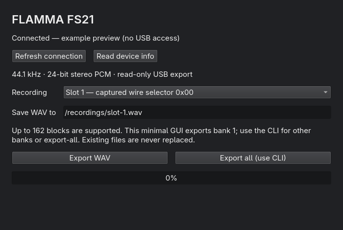

# FS21 Looper Exporter



An independent, MIT-licensed, **read-only** editor/exporter for the
FLAMMA FS21 Looper & Drum, with native Linux support and a portable
Windows preview. No Wine, VM, or manufacturer's editor is required.

**Supports all 40 bank-selection reads and recordings containing up to
162 blocks.** The limit reflects captured block indices **0–161**, not a
bank-specific hardcoded duration. Bank 8's complete 162-block capture
matches the existing checksum algorithm, including index 161 → `0x54`.
Longer recordings are reported as unsupported; no index above 161 is sent.

Selectors for **banks 1–4 and 8 are independently captured**. Selection of
the other 35 banks is **inferred**, not hardware-verified by these captures.
The inferred selector checksum uses the CRC-derived model: the old
additive formula diverges at bank 9. Dry runs show which reads are inferred.

`export-all` attempts all 40 banks, continues after individual failures,
protects existing WAVs, and reports exported/empty/failed/unsupported/skipped
counts. Empty handling recognizes only an explicit zero-block reply; no
empty bank is present in the available captures. A timeout is **never**
treated as empty.

`list` (metadata enumeration) remains unsupported. The GUI lists all 40
slots with individual export buttons and an **Export all 40 slots** action.
See [protocol details](docs/protocol.md) and the
[validation report](docs/validation-report.md).

## Previous live validation (bank 1 only)

On 2026-11-24, native PyUSB export successfully received all **42 blocks**
from the connected FLAMMA FS21. The resulting 61.994-second WAV is
**byte-for-byte identical** to the complete PCAP reconstruction:

```text
WAV SHA-256: f81780389a4bd0013c51343164c3f402a21465de7d8a700c8566d557424dfe11
```

Local outputs are in `artifacts/pedal-slot-1.wav` (live USB) and
`artifacts/capture-recovered.wav` (offline). These are ignored by Git
and not included in the installable package.

A repeated live transfer using the PySide6 GUI's background worker also
completed successfully, saving `artifacts/gui-pedal-slot-1.wav` with the
same hash. No reset or USB reconnect was needed between the exports.

Multi-bank support has been tested with mocks and real captures. This does
**not** establish a live 40-bank or bank-8 hardware export.

## Windows portable preview

Download **FS21-Windows-x64.zip** from
[GitHub Releases](https://github.com/jardous/fs21-edit/releases).
Extract the entire archive and run **FS21.exe**. Keep the `_internal`
directory beside the executables. Python does not need to be installed.
`fs21-cli.exe` provides the same CLI commands in PowerShell.

Windows 10/11 x64 is the target. The build is unsigned and may trigger
SmartScreen. Verify the supplied SHA-256 checksums if needed.
The release includes libusb but may require a **WinUSB** driver for normal
mode `0483:1412`, interface 0. Read `README-Windows.txt` before changing a
driver: this can affect the manufacturer's editor. Do not alter the
firmware/HID device `0483:5703`. No driver is installed automatically.

Native Windows regression and packaged GUI/CLI smoke checks run without a
pedal. **Live Windows USB export has not been verified.** Linux behavior,
the finite command allowlist, and all protocol limits remain unchanged.
Logs for the windowed executable are in `%LOCALAPPDATA%\FS21\fs21.log`.

## Install (Arch Linux)

Python 3.12+ and libusb are required:

```bash
sudo pacman -S python python-pip libusb
python -m venv .venv
.venv/bin/pip install -e '.[dev]'
# Optional GUI:
.venv/bin/pip install -e '.[gui]'
```

Alternatively, use `uv venv` and `uv pip install -e '.[dev,gui]'`.
All commands below assume the environment's `bin` directory is on PATH.
No system Python packages or desktop settings are modified.

For non-root USB access (normal mode only):

```bash
sudo install -m 644 packaging/70-fs21.rules /etc/udev/rules.d/70-fs21.rules
sudo udevadm control --reload-rules
# Unplug and reconnect the pedal.
```

`TAG+="uaccess"` grants access to the active local desktop session; headless
sessions require an administrator-managed group rule. Do not run the editor
as root. The firmware/HID PID is deliberately excluded.

For a temporary grant to the currently enumerated node only:

```bash
lsusb -d 0483:1412
# Substitute the current bus/device from lsusb:
sudo setfacl -m u:"$USER":rw /dev/bus/usb/005/011
```

This ACL disappears on USB reconnect. Do not grant access to all USB nodes.

An optional local Arch package can be built with
`cd packaging && makepkg -si` after installing the listed build dependencies.
It includes the desktop launcher and udev rule; the Python virtualenv
installation does not install system files.

## Use

```bash
fs21 info
fs21 info --json
fs21 export 8                       # Saves ./bank-08.wav
fs21 export 8 ./recordings/bank8.wav
fs21 export 1 recording.wav
fs21 --timeout 5000 --retries 2 export 1 recording.wav
fs21 --usb-address 5:11 info
fs21 export-all --output ./fs21-export
fs21 export-all ./recordings/       # Old positional syntax still works
fs21 export-all --output ./fs21-export --force
fs21 export-all --dry-run           # No USB access
fs21 list                          # Metadata listing unsupported, exit 2
fs21 gui
```

Exports use names `bank-01.wav` … `bank-40.wav`. An existing file is skipped
by export-all unless `--force` is supplied; a single-bank export refuses to
overwrite by default. Re-running export-all therefore resumes missing files.
The final counts are measured results from that run, not example numbers.

Exit codes: **0** = exported/empty/skipped only; **1** = at least one failure;
**2** = unsupported recordings with no other failure. `--json` on export-all
returns one JSON object containing `summary` and per-bank results; progress
and warnings remain on stderr.

### Direct-export script

The single direct-export script defaults to dry-run and delegates USB/export
logic to the same tested package rather than maintaining a second implementation:

```bash
.venv/bin/python scripts/fs21_direct_export.py --bank 8
.venv/bin/python scripts/fs21_direct_export.py --bank 8 --live
.venv/bin/python scripts/fs21_direct_export.py --all --out ./fs21-export --live
```

### Graphical interface

Run `fs21 gui`, choose an **Export folder**, then click **Export** on any
slot's row or **Export all 40 slots**. Files are named `bank-01.wav` through
`bank-40.wav`. Existing files are kept, never overwritten by the GUI.

The list contains only slot numbers and export buttons, without guessing
whether a slot is occupied. Select a slot to see its export result, file path
or detailed error below the list. Block progress, overall batch progress
and measured summary counts are also shown below. Slots needing attention
are identified by number. Batch export continues after individual failures.

USB and WAV operations run in a background worker. Export controls are
disabled during transfers, but the list can still be scrolled and inspected.
Automatic USB connection checks run separately: they do not interrupt folder
editing or refresh unchanged controls and export results.
Wait for the operation to finish before closing; no unverified abort or
automatic USB reset is sent.

| GUI shortcut | Action |
| --- | --- |
| Space / Ctrl+E | Export the selected slot (Space activates a focused button normally) |
| Ctrl+Shift+E | Export all 40 slots |
| Ctrl+R | Refresh connection |
| ? | Show/hide keyboard help |
| Q / Ctrl+Q | Quit when no USB operation is running |

Single-character shortcuts are disabled while typing an export folder.
Enter the folder path directly; no custom or non-portal file dialog is used.

`--verbose` logs protocol headers, lengths, and errors, never audio.
USB option flags go **before** the command. `--force` on `export` permits
replacing a local file only; it never writes recordings to the pedal.
Outputs are published atomically only after the terminal acknowledgment.
Existing files are protected by default. Progress goes to stderr.

Keep the pedal idle and close other editors while exporting. Do not record,
switch slots, disconnect USB, or press pedal controls during a transfer.

### Offline capture tools

```bash
fs21 analyze /path/to/looper.pcap --json
fs21 --capture /path/to/looper.pcap info
fs21 --capture /path/to/looper.pcap export 1 recovered.wav
fs21 --capture /tmp/fs21-bank8.pcapng export 8 recovered-bank8.wav
```

PCAP and PCAPNG with Linux usbmon linktypes 220/189 are read directly,
optionally gzip-compressed, without Wireshark or additional Python packages.
PCAPNG supports enhanced packets, multiple interfaces/sections, either byte
order, and interface timestamp resolutions/offsets. Legacy/simple packet
blocks must be converted with `editcap -F pcap input.pcapng output.pcap`.
`--session N` selects the Nth export matching the requested bank.
Multiple matching USB addresses require `--usb-address`. Offline export-all
is intentionally refused rather than accidentally accessing hardware.

The original extractor missed block zero: `CA 00` receives both `CB 00`
metadata **and the first `CC 00` audio block** before any `CD` request.
This exporter includes that block and requires ordered sequences,
consistent block counts, complete URBs, and a final `CE 00` acknowledgment.

## Safety

The outbound transport accepts only one captured identification request,
40 bounded CA bank selectors, and 162 capture-validated CD acknowledgments.
The uncaptured bank selectors are explicitly inferred read operations.
There is no raw-command option, arbitrary command builder, firmware code,
upload, erase, format, reset, clear-halt, auto-detach, or configuration
change. It claims interface 0 only on an already configured normal-mode
device, checks endpoints, and releases resources on every exit.

Read timeouts/interruption can be retried within a configurable bound.
Writes are never retried: a timeout can mean a command already arrived.
An interrupted export leaves no published partial WAV. No unverified
abort/finish command is sent. Export-all releases and reclaims the interface
per bank. After an empty/failed/unsupported bank it drains stale bulk IN
data to a short quiet timeout within a one-response budget, then requires
fresh device identification before the next CA. This sends no reset, CF, D2,
or other guessed recovery command. Firmware recovery after every possible
failure is not proven; affected banks are reported as failed and the batch
continues. A manual reconnect may still be necessary.

Response trailers are validated against observed values, **not a verified
audio checksum**. Silent corruption cannot currently be detected beyond
USB's link-level integrity and structural checks.

## Development

```bash
pytest
ruff check .
mypy src/fs21
QT_QPA_PLATFORM=offscreen pytest tests/test_gui.py
```

The architecture separates PCAP reading, framing, capture reconstruction,
USB transport, device state, atomic WAV output, CLI, and optional Qt GUI.
Hardware is never accessed by the automated test suite.

### Windows build/release

The manually dispatched **Windows portable release** GitHub Actions workflow
builds on Windows x64, runs tests, freezes the GUI/CLI, packages licenses and
corresponding third-party source archives, and tests the extracted zip outside
the checkout. A new `release_tag` publishes a prerelease only after those
checks succeed; leaving the tag blank produces CI artifacts only.

To build locally on Windows with Python 3.12 x64:

```powershell
python -m pip install -r packaging/windows/requirements-build.txt -e ".[gui,dev]"
python -m pytest -q
python -m PyInstaller --clean --noconfirm packaging/windows/fs21.spec
python packaging/windows/package_release.py
```

The portable build keeps Qt/libusb DLLs separately replaceable, rather than
hiding LGPL components in a single self-extracting executable.

`tests/fixtures/protocol-evidence.json` preserves all 581 CD requests from the
three new captures, plus response prefixes, lengths, trailers, and PCM
hashes. New recordings' PCM is omitted; tests substitute zero PCM while
checking the captured structure and byte-exact outgoing commands. The
original audio-bearing PCAP fixture still tests unchanged WAV reconstruction.

Raw captures and WAV recordings are intentionally excluded from Git. On a
fresh clone, tests requiring the private audio-bearing fixture skip; the
public structural replay tests still run. To enable the private tests,
recreate the fixture as described in `tests/fixtures/README.md`.

Capture-derived fixtures contain the user's audio and are **not covered by
the code's MIT license**. Review/redact or obtain permission before publishing
them. The reference script and original capture are never modified.
